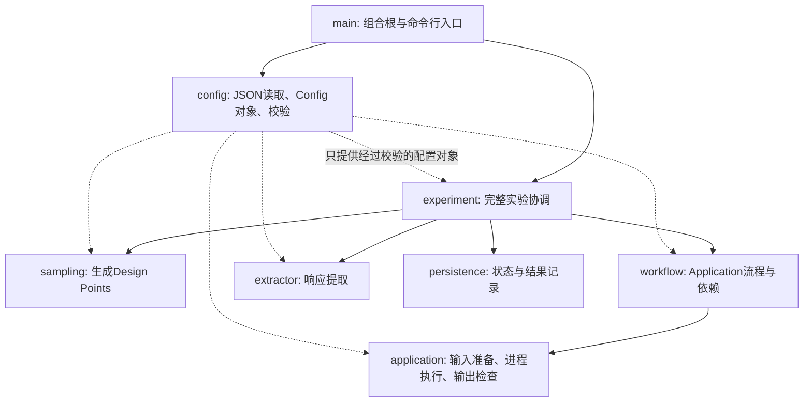

# DOE Engine 总体架构与模块边界

## 1. 文档定位

本文冻结 DOE Engine 当前阶段的总体架构和模块边界，作为后续 C++ 实现、代码审查和配置设计的共同依据。

本文只讨论 DOE Engine。CEP Server、用户权限、Web 前端、Project/Study 管理和科学资产晋升属于更上层产品，不进入首轮 Engine 实现。

当前结论不是要求一次性实现全部能力，而是先固定依赖方向，使各模块可以逐步实现而不必反复推翻边界。

## 2. 产品分层

完整产品分为两层：

```text
CEP Server
    长期运行的计算实验管理平台
    管理用户、Project、Experiment 历史、科学资产和服务接口

DOE Engine
    可独立启动的无状态计算引擎
    读取一次 Experiment 配置，完成采样、计算、提取和记录
```

DOE Engine 不理解 Project、Study、ResearchNote 等 CEP 领域概念。Engine 的入口是一个 `experiment.json`，输出是本次计算实验的运行记录、响应值和计算文件。

首轮开发即使没有 CEP Server，DOE Engine 仍应能够独立用于真实科研任务。以后 CEP Server 通过进程、服务或任务队列调用 Engine，不应要求重写 Engine 的内部模块。

## 3. DOE Engine 的能力边界

首轮 DOE Engine 负责：

1. 加载和校验 Experiment 及其引用的 JSON 配置。
2. 根据 Sampling Strategy 生成 Design Points。
3. 为每个 Design Point 创建独立工作目录。
4. 根据设计变量生成或复制 Application 输入文件。
5. 按 Workflow 规定的顺序执行 Applications。
6. 检查退出码和必须存在的输出文件。
7. 使用 Extractors 从计算输出中提取响应值。
8. 保存设计点、运行状态、错误、响应值及必要的文件信息。
9. 为以后实现中断恢复和失败重试保留稳定边界。

首轮不负责：

- 优化算法、代理模型和自适应采样。
- 聚类、SHAP、响应面分析、神经网络建模等开放式科研分析。
- 科学解释、论文论证和 ResearchNote 的结构化表达。
- CEP 的 Project/Study 管理、用户权限、Web 服务和 GUI。
- 将所有计算结果自动认定为长期科学资产。

这些非目标不能阻止以后扩展，但不应提前进入 Engine 的核心模型。

## 4. 核心概念

### 4.1 Experiment

Experiment 是 DOE Engine 的一次完整输入和运行入口。它引用变量、响应、采样、Workflow 和 Extractor 配置。

一个已经执行过的 Experiment 不原地修改为新的科研方案。用户修改采样范围、水平数或 Workflow 后，应复制形成新的 Experiment，并在未来由 CEP 层记录它们之间的关系。

### 4.2 Design Point

Design Point 是一组完整的设计变量取值。Sampling Strategy 产生 Design Points，后续 Application 和 Extractor 都在某个具体 Design Point 的上下文中运行。

Design Point 是 DOE 领域对象，不等同于工作目录。工作目录只是它在一次运行中的物理载体。

### 4.3 Workflow

Workflow 描述 Applications 的组合、顺序和数据依赖关系。它是一张计算流程图，而不是科研解释过程。

首轮可以只实现串行、无分支或简单有向无环流程，但配置模型不能把 Workflow 固化成单个命令。

Workflow 当前只组织 Applications。Extractors 在 Application Workflow 完成后消费其输出，不作为首轮 Workflow 中与 Application 同级的执行节点。

### 4.4 Application

Application 表示一个可执行的计算步骤。它负责：

- 描述程序、工作目录和启动参数；
- 准备输入文件；
- 启动外部程序；
- 判断退出码是否成功；
- 检查必须存在与可选的输出；
- 通过逻辑输出端口公开产生的文件。

Application 不负责定义 DOE 响应值，也不负责解释输出文件中的科学含义。

用户可以把复杂的 NetCDF 后处理写成第二个 Application。这是允许的，但如果后处理仅仅是从已有计算文件提取标量响应，优先推荐使用 Extractor，以便复用已有计算文件而无需重新运行上游 Application。

### 4.5 Extractor

Extractor 消费一个或多个 Application 输出，产生一个或多个 DOE 响应值。

Extractor 不是 Application 的同义词。它不负责通用流程调度，重点是把计算文件转换为结构化响应值。

首轮支持两类 Extractor：

- 内置文本提取（`delimited_text`）：与 `delimited_text` Tagger 互逆的 detag 模式，按分隔符拆分文本、按行列索引定位单元并映射到 Response；
- 程序式提取，例如调用 Python 脚本解析 NetCDF。

Application 输出端口、Extractor 输入端口和 Extractor 输出端口通过名称连接。例如：

```text
run_model.result_file
        ↓
extract_y1.source_file
        ↓
extract_y1.value
        ↓
response y1
```

端口是逻辑接口，不是网络端口，也不是文件路径。实际文件路径可以变化，而下游连接保持稳定。

### 4.6 Response

Response 是试验设计语境中的响应变量。它是由 Extractor 输出映射得到的结构化标量，不是网络请求的响应概念。

首轮只要求支持实数响应，但配置和 C++ 类型边界应允许以后扩展。

### 4.7 Artifact

Artifact 是 Application 产生的科学或工程文件，例如 `wout.nc`、日志、输入快照和结果文件。

在 DOE Engine 中，Artifact 首先属于具体 Experiment Run 和 Design Point 的计算产物。未来 CEP 可以从这些产物中选择一部分晋升为 Project 级长期科学资产，但不是所有临时文件都自动成为 CEP Artifact。

## 5. 模块关系



依赖方向必须保持自上而下。低层模块不能反向依赖 `experiment` 或 `main`。

## 6. 源码模块职责

### 6.1 `src/config`

负责 JSON 配置文本到 Config 数据实体的映射：

- 定义反序列化后的 Config 数据实体（`VariableConfig`、`ResponseConfig`、`ApplicationConfig` 等）；
- 校验字段类型、必填字段、枚举值和数值范围；
- 解析被引用配置文件的相对路径；
- 执行跨文件引用与端口兼容性校验；
- 产生带文件路径和字段位置的配置错误。

JSON 文件的读取与反序列化实现在 `src/utils/json`，错误类型在 `src/utils/log`。Config 实体只保存数据，不启动程序、不生成采样点、不写数据库。解析管线：

```text
JSON → Parser/Loader → Config对象 → 运行时对象
```

### 6.2 `src/runtime/data`

负责由 Config 实体实例化或运行期产生的运行时数据对象：

- `ScalarValue`：运行时标量值（`int`/`double`/`string`），提供数值感知的全序比较；
- `Variable`：由 `VariableConfig` 实例化，携带元数据与当前值，提供比较运算符；
- `Response`：由 `ResponseConfig` 实例化，携带元数据与一次试验观测到的响应值；
- `DesignPoint`：一次试验，由运行期生成（不来自 Config），持有设计变量取值与观测到的响应值，可用变量取值判等去重。

`runtime/data` 只持有运行数据与轻量行为（取值、比较），不执行采样算法、不启动进程、不读 JSON。

### 6.3 `src/runtime/sampling`

负责根据变量定义和采样配置生成 Design Points。

首轮只实现连续实数变量和等距全因子采样：

- 每个变量可以使用不同水平数；
- 水平数必须大于等于 2；
- 水平值始终包含 `lower_bound` 与 `upper_bound`。

Sampling 不读取 JSON，不创建工作目录，也不运行 Application。

### 6.4 `src/runtime/application`

负责一个 Application 的本地执行能力：

- 普通文件复制；
- `tagged_copy` 输入生成；
- `placeholder_text` 与 `delimited_text` Tagger；
- 命令行进程启动；
- 超时、退出码和输出文件检查；
- 返回逻辑输出端口到实际文件的映射。

Application 不决定自身在 Workflow 中的顺序，也不把文件解析成 Response。

### 6.5 `src/runtime/workflow`

负责：

- 保存 Application 实例和连接关系；
- 校验 Application 图；
- 确定可执行顺序；
- 将上游逻辑输出绑定到下游输入；
- 在单个 Design Point 内组织 Applications。

Workflow 不生成 Design Points，不解释 Response，也不直接持久化数据库。

### 6.6 `src/runtime/extractor`

负责：

- 根据 Extractor 类型构造具体实现；
- 接收由端口绑定提供的输入文件；
- 执行文本或程序式提取；
- 返回具名、带类型的输出值；
- 把错误报告给 Experiment 协调层。

Extractor 不通过硬编码路径寻找 Application 文件。输入必须来自显式端口绑定。

### 6.7 `src/runtime/experiment`

是 DOE Engine 的顶层用例协调模块，负责：

- 接收已经加载并校验的完整 Config；
- 请求 Sampling 生成 Design Points；
- 创建 Run 与 Design Point 工作目录；
- 对每个 Design Point 调用 Workflow；
- 在 Workflow 完成后调用 Extractors；
- 把状态、错误、响应值和文件信息交给 Persistence；
- 决定一次 Experiment 的最终状态。

`experiment` 只做跨模块协调。具体采样算法、进程启动、文本解析和数据库 SQL 必须留在所属模块。

### 6.8 `src/persistence`

负责 DOE Engine 运行行为的记录接口，例如：

- Experiment Run；
- Design Points 及设计变量值；
- Application 运行状态、次数、退出码和错误；
- Extractor 状态和响应值；
- 关键输出文件及其位置；
- 为中断恢复与失败重试提供查询基础。

`persistence` 是可选的插拔接口层：它以接口方式读取并记录系统的行为，不反向驱动运行决策。没有数据库实现时，DOE Engine 仍应能正常完成采样与计算闭环；有数据库实现时，由 Experiment 协调层在关键节点调用它记录状态。首轮数据库语义只属于 DOE Engine，不提前引入 CEP 的 Project、Study、ResearchNote 或科学资产晋升模型。

## 7. 不保留 `src/execution`

不保留独立的 `src/execution`，该目录已移除。

运行职责已经有明确归属（行为模块位于 `src/runtime` 之下，`persistence` 为顶层可选接口层）：

- Experiment 整体协调属于 `experiment`；
- Workflow 遍历属于 `workflow`；
- 外部进程启动属于 `application`；
- 提取器调用属于 `extractor`；
- 状态记录属于顶层 `persistence`。

如果保留一个宽泛的 `execution`，这些职责很容易再次集中到一个杂物模块中，破坏解耦。

以后真正出现并行工作池、Slurm 后端、任务队列、取消、暂停和多执行后端时，再根据实际职责新增独立的执行目录：

```text
src/scheduler/
src/process/
src/executor/
```

`src/runtime` 已用于运行时数据对象与行为模块，不再用于命名未来的执行基础设施。

数据库可以记录运行和尝试次数，但这不要求存在名为 Execution 的领域实体或源码目录。

## 8. 一次 Experiment 的运行链路

```text
1. main 接收 experiment.json
2. config 加载全部被引用配置并完成校验
3. experiment 请求 sampling 生成 Design Points
4. experiment 创建本次 run_dir
5. 为每个 Design Point 创建 design_point_dir
6. workflow 按顺序调度 Applications
7. application 生成输入、运行程序、检查必需输出
8. extractor 通过逻辑端口消费 Application 输出
9. extractor 输出映射为 Responses
10. persistence 保存状态、设计值、响应值和文件信息
11. experiment 汇总最终状态并返回给 main
```

首轮可以串行执行所有 Design Points，但模块接口不能假设未来永远只有串行执行。

## 9. 运行目录与路径上下文

当前路径上下文固定为：

```text
{experiment_dir}
    experiment.json 所在目录

{run_dir}
    {experiment_dir}/runs/<run_id>

{design_point_dir}
    {run_dir}/DESIGN_POINT_<index>
```

中间不增加 `design_points/` 目录。

配置文件之间的 `file` 引用相对于包含该引用的 JSON 文件解析。Application 和 Extractor 的运行时路径使用上述保留字段，不使用旧的 `{project}`、`{workspace}`、`{experiment}`。

## 10. 跨平台约束

DOE Engine 以 Windows 和 Unix/Linux 为共同目标：

- 本地路径使用 `std::filesystem::path`，不手工拼接 `\\` 或 `/`；
- JSON 内部引用使用可移植的相对路径；
- 不通过拼接 shell 字符串启动程序；
- 进程启动层需要分别适配 Windows 与 POSIX，但向 Application 暴露统一接口；
- 参数数组必须保持参数边界，路径中允许空格；
- 文本读取应兼容 `LF` 与 `CRLF`；
- 不假设可执行文件一定具有 `.exe` 后缀；
- 测试 Fixture 可以包含平台专用程序，但核心配置模型不能绑定到单一平台；
- 文件名和错误信息需要考虑 Unicode 路径；
- CMake 不依赖 Visual Studio 专有工程文件，优先使用标准 CMake target。

## 11. 依赖与构造原则

所有模块遵守以下约束：

1. `main` 是组合根，只负责命令行、组装和最终错误码。
2. Config 对象与运行时对象分离。
3. 运行时对象不保存 JSON 节点。
4. 不使用全局可变单例保存当前 Experiment。
5. Application、Extractor 和 Sampling 的具体类型通过工厂构造，调用者依赖接口。
6. 文件路径、Design Point 和端口绑定通过显式上下文传递，不依赖进程当前目录的隐式状态。
7. 失败必须携带明确阶段、对象 ID、文件路径和原因。
8. 模块之间传递结构化结果，不通过解析日志文本判断成功。
9. 首轮不为了假想需求建立空的抽象层；当第二种真实实现出现时再提取公共接口。

## 12. 推荐源码结构

```text
DOE_ENGINE/
├── src/
│   ├── config/
│   ├── persistence/
│   ├── runtime/
│   │   ├── data/
│   │   ├── sampling/
│   │   ├── application/
│   │   ├── workflow/
│   │   ├── extractor/
│   │   └── experiment/
│   ├── utils/
│   │   ├── json/
│   │   └── log/
│   └── main.cc
├── tests/
│   ├── unit/
│   ├── integration/
│   └── fixtures/
├── examples/
├── third_party/
└── doc/
```

`tests/fixtures` 服务于自动化测试，`examples` 服务于用户学习和真实案例展示。完整案例是否属于 Fixture，不取决于它是否完整，而取决于它的主要用途是自动验证还是用户教学。

## 13. 架构稳定点

后续逐步实现时，以下结论视为当前稳定约束：

- CEP Server 与 DOE Engine 分层；
- `experiment.json` 是 Engine 的配置入口；
- Config 数据实体在 `src/config`，JSON 解析在 `src/utils/json`；
- Config 对象与运行时对象分离；
- 运行时数据对象在 `src/runtime/data`，行为模块在 `src/runtime`（sampling、application、workflow、extractor、experiment）；
- `persistence` 是顶层可选接口层，记录系统行为，缺失时系统仍可运行；
- Sampling、Application、Workflow、Extractor 各自独立；
- Extractor 通过端口消费 Application 输出；
- Response 是 DOE 响应变量；
- Artifact 是文件型计算产物；
- 不建立 Evaluation、StepRun、Activity 等首轮核心实体；
- 不保留宽泛的 `src/execution`；
- 运行目录没有 `design_points/` 中间层；
- 首轮优先完成可靠、可复现的采样与计算闭环。
